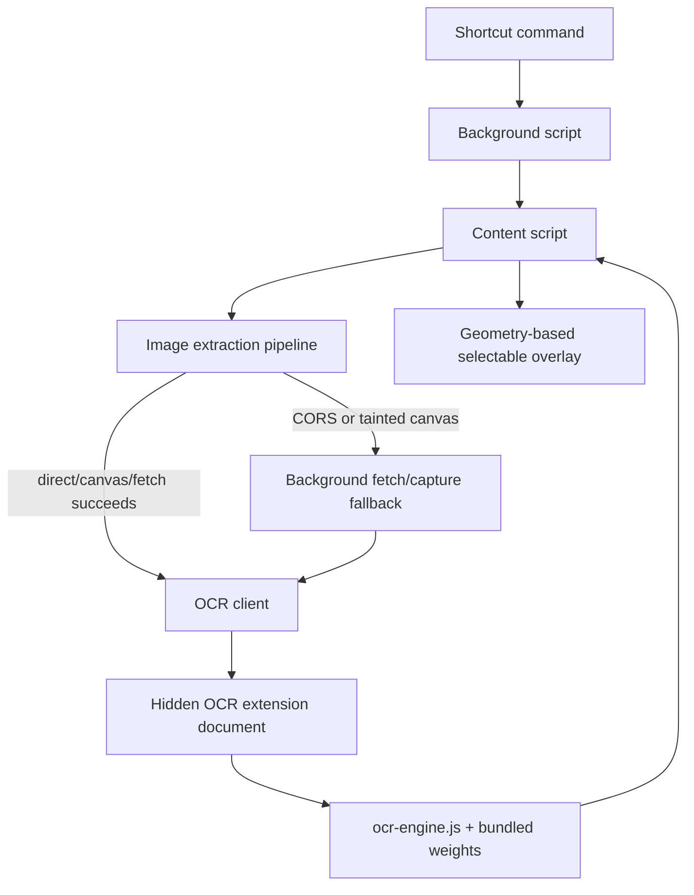

# feat: Add Firefox extension support

## Summary

Add Firefox support to Loupe while preserving the Chrome extension behavior. The plan keeps one source tree, introduces browser-specific manifest/build outputs, replaces the Chrome-only offscreen OCR path with a cross-browser hidden document path, and adds overlay positioning fallback logic for browsers without reliable CSS anchor positioning.

---

## Problem Frame

Loupe already claims Manifest V3 support for Chrome and Firefox in `README.md`, but the current implementation is Chrome-shaped. `manifest.json` declares the Chrome `offscreen` permission, `background.js` depends on `chrome.offscreen`, and all extension calls use the `chrome.*` namespace directly. `overlay.js` also requires CSS anchor positioning, which is not a safe cross-browser baseline for Firefox users.

Firefox compatibility should not fork the product into two implementations. The user-facing behavior remains: hover an image or canvas, press the shortcut, run OCR locally with bundled model files, and render selectable text over the original element.

---

## Requirements

- R1. Firefox can load the extension from a generated manifest without unsupported Chrome-only permissions or APIs.
- R2. Chrome continues to load and run Loupe with the existing command, background messaging, OCR, fetch fallback, visible-tab capture fallback, and overlay behavior.
- R3. OCR execution works in Firefox through an extension-owned hidden document or equivalent DOM-capable context that can load `ocr-engine.js` and bundled model weights.
- R4. Content scripts use a browser API adapter so request/response behavior is consistent across Chrome callback-style compatibility and Firefox promise-style WebExtensions APIs.
- R5. The overlay remains aligned to the target image or canvas in Firefox even when CSS anchor positioning is unavailable.
- R6. Cross-origin image handling preserves the current order of attempts: direct canvas draw, content-script fetch, background fetch where needed, and visible-tab capture as the last fallback.
- R7. Packaging produces separate Chrome and Firefox extension artifacts from the same source files and documents browser-specific load instructions.
- R8. Firefox distribution metadata declares a Gecko extension ID and no external data collection.

---

## Key Technical Decisions

- KTD1. Keep Manifest V3 and generate browser-specific manifests: MDN documents that Chrome MV3 uses `background.service_worker` while Firefox MV3 still uses `background.scripts`. A generated Chrome manifest should use the service-worker background plus `offscreen`, while a generated Firefox manifest should use background scripts, omit `offscreen`, and include `browser_specific_settings.gecko.id` for signing.
- KTD2. Introduce a small extension API adapter instead of rewriting the codebase to `browser.*`: Firefox supports `chrome.*` for compatibility, but MDN recommends `browser.*` and promises for cross-browser code. A local adapter centralizes namespace and callback/promise differences without spreading compatibility branches across OCR logic.
- KTD3. Replace Chrome offscreen as the primary OCR abstraction with an OCR host abstraction: Chrome still needs an offscreen document because its MV3 service worker has no DOM access, while Firefox can use its background document or another extension-owned document because `background.scripts` run in a document context. The shared contract is message-based OCR hosting, not a shared browser API.
- KTD4. Preserve visible-tab capture as a fallback but verify permission behavior in Firefox: MDN states `tabs.captureVisibleTab()` requires `<all_urls>` or `activeTab`, and Firefox versions before 126 required `<all_urls>`. Loupe already requests `activeTab` and `<all_urls>`, so the plan keeps both until Firefox manual verification proves a narrower set is sufficient.
- KTD5. Use geometry-driven overlay positioning as the compatibility baseline: CSS anchor positioning is convenient, but Loupe needs a Firefox-safe path. The overlay should compute and track target bounding boxes with scroll, resize, and mutation observers, while the anchor-based path may remain as an enhancement when supported.
- KTD6. Add Node built-in tests and browser smoke checklists before packaging: the repo has no test harness today, so lightweight built-in tests should protect manifest generation, adapter behavior, and overlay geometry without adding runtime dependencies.

---

## High-Level Technical Design

The compatibility seam is between the content script/background messaging layer and the OCR host. Browser-specific manifest generation decides whether the host is reached through Chrome offscreen or Firefox document-backed background code, but `content.js` should not know which browser is running.

---

## Scope Boundaries

### In Scope

- Cross-browser manifest generation for Chrome and Firefox.
- Replacement of direct `chrome.offscreen` coupling with a Firefox-safe OCR document path.
- Adapter-based WebExtensions API access in `background.js`, `content.js`, and `offscreen.js` or their replacements.
- Overlay alignment fallback that does not require CSS anchor positioning.
- Lightweight tests and manual browser verification documentation.

### Deferred to Follow-Up Work

- Publishing automation for Chrome Web Store or AMO.
- Firefox Android support.
- OCR model changes, recognition quality improvements, or WebGPU/WebAssembly engine rewrites.
- Permission minimization beyond preserving the current fallback behavior.

---

## System-Wide Impact

The change affects all extension surfaces: manifest metadata, background command routing, content-script messaging, OCR engine lifecycle, packaged model resource URLs, and overlay layout. The main compatibility risk is not OCR math; it is browser runtime shape around DOM access, messaging promises, packaged resource URLs, and tab capture permissions.

---

## Implementation Units

### U1. Browser-specific manifest generation

- **Goal:** Produce valid Chrome and Firefox manifests from one source of truth.
- **Requirements:** R1, R2, R7, R8.
- **Dependencies:** None.
- **Files:** `manifest.json`, `manifest.chrome.json`, `manifest.firefox.json`, `scripts/build-extension.js`, `package.json`, `tests/manifest.test.js`, `README.md`.
- **Approach:** Treat the current `manifest.json` as the shared base, then generate `dist/chrome/manifest.json` and `dist/firefox/manifest.json`. The Chrome manifest uses `background.service_worker` and retains `offscreen`; the Firefox manifest uses `background.scripts`, removes `offscreen`, includes `browser_specific_settings.gecko.id`, declares `data_collection_permissions.required: ["none"]`, and keeps bundled model files in MV3 `web_accessible_resources`.
- **Patterns to follow:** Current manifest content in `manifest.json`; README's existing offline and Firefox claims.
- **Test scenarios:**
  - Given the manifest generator runs, when it writes the Firefox manifest, then permissions exclude `offscreen`, background uses scripts, and the existing command, content scripts, icons, host permissions, and model resources remain present.
  - Given the manifest generator runs, when it writes the Chrome manifest, then background uses `service_worker`, Chrome-only offscreen support remains available, and the current user-facing metadata is preserved.
  - Given generated manifests are parsed by tests, when required Firefox metadata is absent, then the test fails with a clear field name.
- **Verification:** Generated Chrome and Firefox extension directories contain all required scripts, icons, model files, and exactly one browser-appropriate manifest each.

### U2. WebExtensions API adapter

- **Goal:** Centralize `chrome.*` and `browser.*` differences for runtime messages, command listeners, tab messages, resource URLs, and visible-tab capture.
- **Requirements:** R2, R4, R6.
- **Dependencies:** U1.
- **Files:** `extension-api.js`, `background.js`, `content.js`, `offscreen.js`, `tests/extension-api.test.js`.
- **Approach:** Add a minimal adapter loaded before other extension scripts. It exposes stable methods for `runtime.sendMessage`, `runtime.onMessage`, `runtime.getURL`, `commands.onCommand`, `tabs.sendMessage`, and `tabs.captureVisibleTab`. The adapter normalizes promise and callback results while preserving asynchronous `sendResponse` behavior in message listeners.
- **Patterns to follow:** Existing message types in `background.js` and `content.js`: `run-ocr`, `fetch-image`, `capture-visible`, and `ocr-process`.
- **Test scenarios:**
  - Given a promise-based Firefox-like API mock, when `sendMessage` resolves, then the adapter returns the resolved value unchanged.
  - Given a callback-based Chrome-like API mock, when `sendMessage` invokes its callback, then the adapter resolves with the callback value and surfaces runtime errors as rejected promises.
  - Given a message listener returns an async result, when installed through the adapter, then the caller receives one response and the listener keeps the channel open only when needed.
  - Given both `browser` and `chrome` globals exist, when the adapter initializes, then it uses the promise-native namespace consistently.
- **Verification:** `background.js`, `content.js`, and OCR document code no longer call `chrome.*` directly except inside the adapter.

### U3. Cross-browser OCR host lifecycle

- **Goal:** Run `ocr-engine.js` behind a browser-neutral OCR host contract that works in Firefox and remains usable in Chrome.
- **Requirements:** R2, R3, R4, R6.
- **Dependencies:** U1, U2.
- **Files:** `background.js`, `ocr-document.html`, `ocr-document.js`, `offscreen.html`, `offscreen.js`, `ocr-engine.js`, `tests/ocr-document-routing.test.js`.
- **Approach:** Rename or replace the offscreen-specific page with an OCR host abstraction. Chrome creates a bundled OCR document through offscreen behind the adapter; Firefox routes OCR to its document-backed background or another extension-owned document that can receive messages and load the same engine. The message contract remains `ocr-process` with an image data URL input and `{ result }` or `{ error }` output.
- **Execution note:** Add characterization tests for the current `ocr-process` request/response contract before moving code out of `offscreen.js`.
- **Patterns to follow:** `offscreen.js` engine initialization, `window.LoupeEngine.init(chrome.runtime.getURL('.'))`, and `content.js` data URL conversion.
- **Test scenarios:**
  - Given the first OCR request in a browser session, when the OCR document is not initialized, then the engine initializes once and returns regions for the message response.
  - Given two OCR requests arrive close together, when initialization is still pending, then both reuse the same init promise and neither creates duplicate engine state.
  - Given engine initialization fails because WebGL2 or model loading fails, when OCR is requested, then the response contains an error that `content.js` can display.
  - Given the Firefox manifest path is used, when the OCR host requests model files, then URLs resolve from the extension package rather than the page origin.
- **Verification:** Chrome and Firefox both complete the same OCR message flow without content-script access to the OCR engine internals or browser-specific host details.

### U4. Firefox-safe overlay positioning

- **Goal:** Keep selectable text overlays aligned without requiring CSS anchor positioning.
- **Requirements:** R2, R5.
- **Dependencies:** None.
- **Files:** `overlay.js`, `tests/overlay-positioning.test.js`.
- **Approach:** Extract overlay placement into a positioning helper. Prefer geometry from `getBoundingClientRect()` plus viewport scroll/resize updates as the baseline, and use CSS anchor positioning only when feature detection confirms support. The fallback should update host `top`, `left`, `width`, and `height` directly and clean up observers when the overlay is removed.
- **Patterns to follow:** Existing `createOverlayElement`, `fitText`, `ResizeObserver`, `MutationObserver`, and `removeOverlay` cleanup behavior in `overlay.js`.
- **Test scenarios:**
  - Given CSS anchor positioning is unsupported, when an overlay is created for a target with a known bounding rectangle, then host geometry matches the target rectangle.
  - Given the page scrolls or resizes after overlay creation, when the positioning helper updates, then overlay geometry remains aligned to the target.
  - Given an overlay is removed, when cleanup runs, then selection, mutation, resize, and scroll listeners are disconnected.
  - Given CSS anchor positioning is supported, when the enhancement path is selected, then existing anchor behavior remains available without breaking the fallback path.
- **Verification:** Manual Firefox smoke testing shows overlay text tracks the target image/canvas through initial render, scroll, resize, and selection.

### U5. Cross-origin and visible capture parity

- **Goal:** Preserve the current fallback ladder for images and canvases under Firefox.
- **Requirements:** R2, R4, R6.
- **Dependencies:** U2, U3.
- **Files:** `content.js`, `background.js`, `tests/image-extraction-routing.test.js`, `README.md`.
- **Approach:** Keep `tryCanvasDraw`, content-script fetch, background fetch, and visible-tab capture as separate fallbacks. Route background fetch and capture through the adapter so Firefox promise rejection and Chrome callback error cases surface the same way to `content.js`.
- **Patterns to follow:** Current `getImageData`, `tryFetchAndDraw`, `tryCaptureInPlace`, `fetchImage`, and `captureVisible` functions.
- **Test scenarios:**
  - Given direct canvas draw succeeds, when OCR starts, then no background fetch or capture request is sent.
  - Given direct draw fails and content-script fetch succeeds, when OCR starts, then fetched pixels are used without visible-tab capture.
  - Given direct draw and fetch fail, when the element is visible, then visible-tab capture crops the element rectangle and returns offsets for overlay placement.
  - Given visible-tab capture rejects in Firefox, when OCR starts, then the user sees a failure status rather than a silent no-op.
- **Verification:** Firefox and Chrome both run OCR on same-origin images, cross-origin images, canvas elements, and capture-fallback cases.

### U6. Packaging, documentation, and browser smoke verification

- **Goal:** Make it clear how to build, load, and verify both browser variants.
- **Requirements:** R1, R2, R7, R8.
- **Dependencies:** U1, U2, U3, U4, U5.
- **Files:** `README.md`, `docs/firefox-testing.md`, `scripts/build-extension.js`, `tests/package-contents.test.js`.
- **Approach:** Document Chrome and Firefox loading paths, shortcut behavior, required WebGL2 support, and known fallback behavior. Package checks should assert that Firefox artifacts exclude Chrome-only files or permissions where possible while still including OCR weights and icons.
- **Patterns to follow:** Existing README feature, usage, requirements, and offline claims.
- **Test scenarios:**
  - Given a Firefox build artifact, when package contents are inspected, then it includes `ocr-engine.js`, OCR document files, model manifest, both weight binaries, content scripts, overlay script, and icons.
  - Given a Chrome build artifact, when package contents are inspected, then it preserves the Chrome-compatible manifest and OCR execution document.
  - Given documentation is updated, when a user follows the Firefox loading instructions, then the expected generated directory and manual smoke checklist are named unambiguously.
- **Verification:** A human can load the generated Firefox artifact in `about:debugging`, run the shortcut on image and canvas fixtures, and compare behavior with the Chrome artifact.

---

## Risks & Dependencies

- **Firefox MV3 background differences:** Firefox does not support extension background service workers the same way Chrome does, so the plan relies on generated Firefox background scripts and a DOM-capable OCR document path.
- **Hidden OCR document lifecycle:** Firefox may require a visible or background extension document strategy different from Chrome offscreen. Keep this isolated behind the OCR document abstraction so implementation discovery does not leak into content-script behavior.
- **Large bundled model files:** Both browser packages must include `det_weights_f16.bin`, `rec_weights_f16.bin`, and `model_manifest.json`; missing files will look like OCR engine failures rather than packaging failures.
- **Overlay alignment regressions:** Replacing CSS anchors with geometry updates can introduce scroll and zoom edge cases. U4 includes explicit scroll/resize scenarios to contain this risk.
- **Permission review:** Keeping `<all_urls>` and `activeTab` maximizes parity for capture/fetch fallback, but AMO review may require clear justification in documentation.

---

## Documentation / Operational Notes

- `README.md` should stop implying Firefox support is already complete until the Firefox artifact and smoke checklist exist.
- `docs/firefox-testing.md` should include manual cases for same-origin image, cross-origin image, canvas, visible capture fallback, vertical text, overlay selection, and WebGL2 failure messaging.
- AMO metadata should state that OCR runs locally and that Loupe does not collect or transmit external data.

---

## Sources & Research

- `manifest.json` currently declares Manifest V3, `activeTab`, `offscreen`, `<all_urls>`, commands, content scripts, and model resources.
- `background.js` currently handles shortcut routing, background fetch, visible-tab capture, and Chrome offscreen OCR dispatch.
- `content.js` currently owns hover target tracking, image extraction fallback order, OCR request dispatch, and user status messages.
- `offscreen.js` currently owns `LoupeEngine` initialization and OCR processing in a DOM-capable extension page.
- `overlay.js` currently uses CSS anchor positioning for overlay placement and observers for text fitting and cleanup.
- MDN: `background` manifest key documents cross-browser MV3 background differences and recommends specifying both scripts and service worker for cross-browser cases where appropriate.
- MDN: `browser_specific_settings` is mandatory for Firefox MV3 signing and now includes data collection permissions for AMO submissions.
- MDN: `tabs.captureVisibleTab()` requires `<all_urls>` or `activeTab`, with older Firefox versions requiring `<all_urls>`.
- MDN: cross-browser extension guidance recommends handling API namespace, promise behavior, function coverage, background context differences, manifest keys, packaging, and publishing together.
- Chrome Developers: `chrome.offscreen` is a Chrome MV3 API for hidden DOM documents because service workers lack DOM access.
